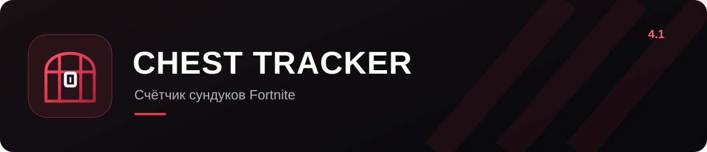

<p align="center">
  
</p>

<p align="center">
  <a href="https://github.com/kenzoll/ChestTracker/releases/latest/download/ChestTracker.exe"><strong>Скачать приложение</strong></a>
  &nbsp;·&nbsp;
  <a href="https://github.com/kenzoll/ChestTracker/releases">Версии и обновления</a>
</p>

Chest Tracker считает сундуки в Fortnite и показывает, сколько ты нашёл за матч, за день и за всё время.

### Сундуки считаются сами

Приложение читает запись матча и добавляет результат в общую сумму. Учитываются обычные пиратские и редкие сундуки — открытые вручную, разбитые киркой или оружием. Сундуки с духами в счёт не идут.

На вкладке «Счетчик» один раз укажи, сколько сундуков было открыто до начала учёта. После этого кнопка «Добавить сундуки» пригодится для игр, которые приложение пропустило.

### Каждый матч остаётся в истории

Выбери день, чтобы посмотреть сумму и матчи за эту дату. В подробностях видно, когда ты открыл или разбил каждый сундук. Если исходный повтор ещё лежит в Fortnite, выбери матч и нажми «Пересчитать матч». Общий итог и сумма за день обновятся вместе с записью.

### Отмечай то, что уже выпало

Награды сезона собраны по неделям: скины, кирки, украшения, музыка, загрузочные экраны и доступ к Pirate Shop. У каждой награды есть изображение. Нажми на карточку, чтобы отметить полученное; повторное нажатие снимет отметку.

Для неполученных наград показана вероятность хотя бы одного выпадения за число сундуков в твоём общем счётчике. Это оценка по обычным шансам сезона: прошлые открытия не повышают шанс следующего сундука.

### Планируй маршрут по карте

На карте можно приблизить нужную локацию и посмотреть расположение сундуков. Обычные, закопанные и редкие включены сразу. Остальные объекты можно добавить фильтрами, а ненужные — скрыть.

Во вкладке «Маршруты» есть 14 готовых пробегов через несколько районов. Красные стрелки показывают переходы между районами. Нажми на номер района на карте, чтобы увидеть порядок обхода сундуков внутри него.

Свой маршрут можно построить от выбранного района с целью от 60 до 250 сундуков. Если не хочется переправляться, включи «Меньше переправ». Удачный пробег можно сохранить под своим названием и открыть в разделе «Мои маршруты».

### Дух перед следующей игрой

Через 15 секунд после записи матча приложение напомнит поставить духа, когда Fortnite активен. Полоска показывает, сколько времени окно ещё будет на экране. Через 6 секунд оно закроется само. Напоминание можно отключить в настройках.

---

### Перед первым матчем

В Fortnite включи **Настройки → Игра → Повторы → Записывать повторы**, затем оставь Chest Tracker запущенным и сыграй матч. Результат появится, когда игра закончит запись повтора.

Старые матчи без сохранённых повторов восстановить не получится.

<details>
<summary>Сборка из исходников</summary>

Понадобятся Windows и .NET SDK 10.

```powershell
dotnet publish src/ChestTracker.csproj -c Release -o publish
publish/ChestTracker.exe --self-test report.txt
```

История и настройки хранятся в `%LOCALAPPDATA%/ChestTrackerDesktop`.

</details>

<details>
<summary>Карта, изображения и сторонние компоненты</summary>

Карта и изображения наград — Fortnite.gg / Epic Games. Лицензии библиотек собраны в [Notices.txt](src/Assets/Notices.txt) и папке [lib](src/lib).

Chest Tracker — неофициальное приложение, не связанное с Epic Games.

</details>
